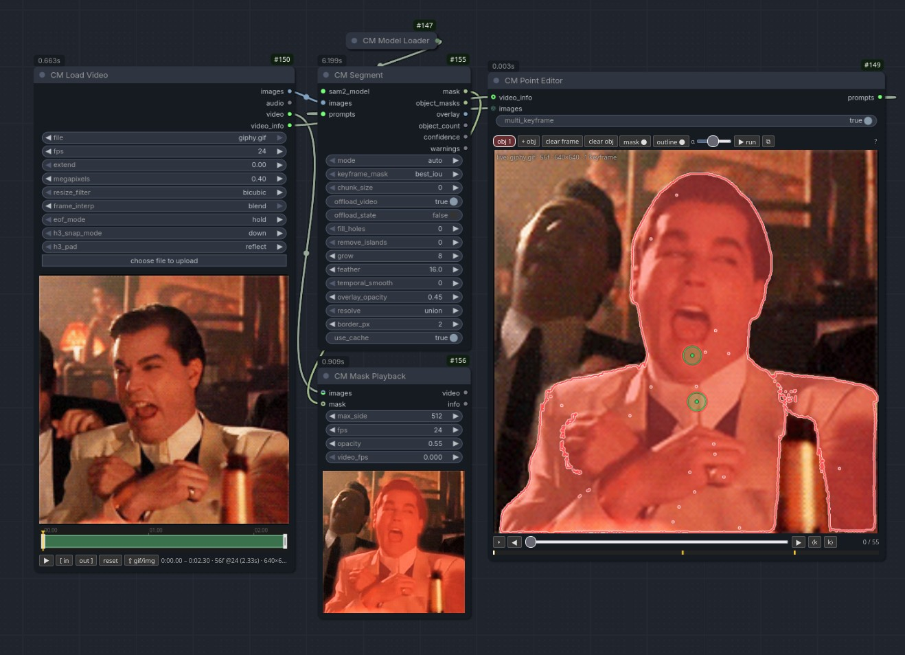

# CoordinationMatrix

SAM2.1 point/box segmentation for ComfyUI with a MiniMax H3-aware video loader.
V3 node API only (`comfy_entrypoint`), LiteGraph + DOM widgets (no Vue), category `CoordinationMatrix`.

## Nodes
| Node | Inputs | Outputs |
|---|---|---|
| CM Model Loader | model, precision, device | sam2_model |
| CM Load Video | file (upload), fps=24, [start, trim on the timeline only], extend, megapixels=0.4, resize_filter=bicubic, frame_interp (nearest/blend), eof_mode (hold/loop), h3_snap_mode (down/nearest/up), h3_pad (reflect/hold) | images, audio, video, video_info |
| CM Video Info | video_info | width, height, length, fps, duration (FLOAT), first_frame, last_frame, original_frames, start, trim, source_fps, source_frames, source_path |
| CM Point Editor | video_info?, images?, multi_keyframe=False | prompts |
| CM Segment | sam2_model, images, prompts, mode=auto, keyframe_mask=best_iou, chunk_size=0, offload_video, offload_state, fill_holes=0, remove_islands=0, grow=1, feather=1.0, temporal_smooth=0, overlay_opacity=0.45, resolve=union, border_px=2, use_cache | mask, object_masks, overlay, object_count, confidence, warnings |
| CM Mask Playback | images (Image/Video)?, mask?, max_side=512, fps=24, opacity=0.55, video_fps (adv) | video, info |

## Install
Clone into `ComfyUI/custom_nodes` and install deps:
`git clone <repo-url> CoordinationMatrix`
`pip install -r requirements.txt`
Weights (`Kijai/sam2-safetensors`) auto-download into `models/sam2` on first run.

Length is always snapped to the H3 17k+5 grid (snap down/nearest/up; pad reflect/hold when growing).

Supported inputs: mp4/mov/mkv/webm/avi/m4v/ts/m2ts/ogv/3gp/asf/vob/mxf and friends via av/ffmpeg,
plus GIF / animated WebP / APNG / AVIF / stills (png/jpg/bmp/tiff/…) via Pillow with true per-frame
delays. `frame_interp=blend` (default) crossfades neighbours when resampling, so low-fps GIFs reach
24 fps without steppy holds; `nearest` is the legacy hold behaviour and is bit-identical to `blend`
whenever the output grid matches the source. `eof_mode=loop` wraps short GIFs/stills from the window
start instead of holding the last frame.

## Point editor controls
- Click / Shift+click: positive point · right-click empty / Shift+right-click: negative point
- Right-click a point or box: delete · drag a point: move
- Ctrl+drag: box · drag a corner: resize · drag inside: move
- Alt+wheel: change frame · ⧉ pops the editor out into a floating panel
- Single-keyframe mode (default): prompting another frame moves the keyframe there.
